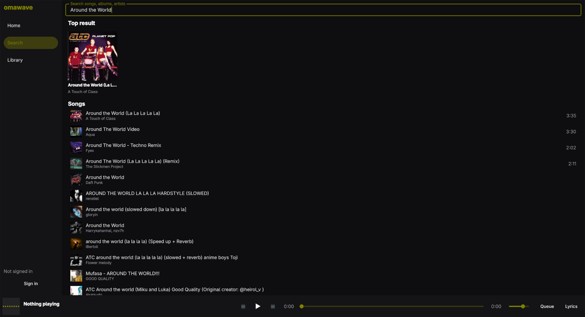

# omawave



A YouTube Music player for [Omarchy](https://omarchy.org), in two parts:

- **`omawave`**, a Qt 6 app that owns playback (mpv + yt-dlp) with Home, Search, Library, album, artist and playlist pages, a queue and synced lyrics. Closing the window releases its interface while playback and the queue continue; reopening starts on Home. MPRIS is built in, so media keys work.
- **`vp.omawave`**, an Omarchy bar widget: a live audio visualizer (via `cava`), a scrolling "title · artist" label, play/pause, next and like buttons, and a mini-player popup with seek, transport, queue, lyrics and a Settings tab that changes the widget live.

The app uses Qt Quick's software renderer; it does not need GPU rendering for its interface.

After one minute paused or idle, omawave stops mpv to release its memory. The queue and position remain available; the next playback or queue command restarts mpv and restores them, so it may take longer.

For faster seeking, mpv stores network audio packets in a temporary disk cache. It also downloads the next YouTube Music track to a temporary cache when possible, up to 32 MiB. Downloads stop after two minutes, and playback falls back to streaming if they fail. Cache files are removed during normal shutdown; an interrupted process can leave files behind.

## Install

```sh
omarchy-pkg-add cava python-ytmusicapi
bin/install
```

`bin/install` builds the package, enables the `omawave` user service, links the plugin and enables it in the bar. For plugin development against the repo copy, run `bin/dev-plugin`.

## Sign in

Library → Sign in. omawave imports the YouTube session of a browser where you are already signed in at music.youtube.com (chromium, chrome, brave, firefox, vivaldi, edge, opera). Cookies are kept in `~/.config/omawave` with mode 0600.

## CLI

```text
omawave                 show the window (starts the app if needed)
omawave --background    start hidden
omawave status [--json] | play-pause | next | previous | show | quit
```

## Shortcuts

| Window | |
|---|---|
| Space | play / pause |
| Ctrl+Right / Ctrl+Left | next / previous |
| Right / Left | seek ±10 s |
| + / − | volume ±5 |
| 1 / 2 / 3 | Home / Search / Library |
| / or Ctrl+F | search |
| U / L | queue / lyrics pane |
| W | start My Wave (Mood / Activity / Character chips on Home) |
| F / D | like / dislike (dislike skips) |
| N | now-playing page |
| Esc | back |
| ? | shortcut overlay |
| Q / Ctrl+Q | hide window / quit |

| Popup | |
|---|---|
| Space | play / pause |
| Left / Right (h / l) | previous / next |
| Up / Down (j / k) | move queue cursor |
| Enter | play selected row |
| x / Delete | remove selected row |
| y | toggle Queue / Lyrics |
| o | open omawave |
| w | start My Wave |
| + / - | like / dislike (dislike skips) |
| Esc | close |

## Notes

- It uses an unofficial YouTube Music API (`ytmusicapi`); it may break when YouTube changes.
- Lyrics come from [LRCLIB](https://lrclib.net).
- Inspired by [LastWave-native](https://github.com/Clash-Projects/LastWave-native); no code was copied.
- MIT licensed. Theme, translator and build scripts derive from Omacut and Monologue (MIT, David Heinemeier Hansson).
